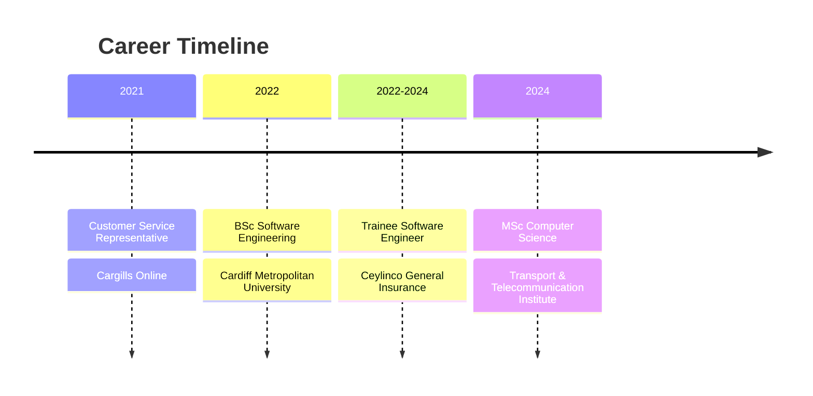

<div align="center">
  
<!-- Animated Header -->


<!-- Typing Animation -->
<a href="https://git.io/typing-svg">
  
</a>

<!-- Profile Views & Social Badges -->
<p>
  
  <a href="https://github.com/kulasekara02?tab=followers">
    
  </a>
</p>

</div>

---

##  About Me


I am a **Software Engineer** with nearly **3 years** of hands-on experience in web development, API integration, and database management. Currently pursuing my **Master's in Computer Science** at the Transport and Telecommunication Institute in Riga, Latvia.

<br/>

🎓 **MSc Computer Science** — Transport & Telecommunication Institute *(2024 - Present)*

💼 **Former Trainee Software Engineer** — Ceylinco General Insurance *(2022 - 2024)*

🎯 **Specialisation:** Enterprise Applications, Oracle PL/SQL, Full-Stack Development

🌍 **Based in:** Riga, Latvia 🇱🇻

<br clear="right"/>

---

##  Technical Arsenal

<div align="center">

<!-- Main Tech Stack Icons -->


</div>

---

### 🗄️ Database Engineering & Backend Systems

<table>
<tr>
<td width="50%" valign="top">

####  Oracle Technologies
```yaml
Oracle Database:
  ├── PL/SQL Development    ████████████████████  Expert
  ├── Stored Procedures     ████████████████████  Expert
  ├── Packages & Triggers   ████████████████████  Expert
  ├── Performance Tuning    ██████████████████░░  Advanced
  ├── Query Optimisation    ██████████████████░░  Advanced
  └── Large Table Handling  ████████████████████  Expert

Oracle Forms & Reports:
  ├── Form Development      ██████████████████░░  Advanced
  ├── Report Generation     ██████████████████░░  Advanced
  └── Enterprise Apps       ████████████████░░░░  Proficient
```

</td>
<td width="50%" valign="top">

####  Database Management
```yaml
PostgreSQL:
  ├── Database Design       ██████████████████░░  Advanced
  ├── Query Optimisation    ████████████████░░░░  Proficient
  └── Schema Management     ██████████████████░░  Advanced

MySQL:
  ├── Database Admin        ████████████████░░░░  Proficient
  ├── Query Development     ██████████████████░░  Advanced
  └── Data Modelling        ████████████████░░░░  Proficient

Data Formats:
  ├── XML Processing        ██████████████████░░  Advanced
  ├── JSON Handling         ████████████████████  Expert
  └── YAML Configuration    ████████████████░░░░  Proficient
```

</td>
</tr>
</table>

---

### 💻 Programming Languages

<table>
<tr>
<td width="33%" align="center">

#### Backend Languages


```
████████████████████ Expert
```
RESTful APIs • MVC Architecture
Backend Systems • Web Services


```
██████████████████░░ Advanced
```
Automation • Data Analysis
Machine Learning • Scripting


```
████████████████░░░░ Proficient
```
OOP • Application Development
Enterprise Solutions

</td>
<td width="33%" align="center">

#### Frontend Languages


```
████████████████████ Expert
```
ES6+ • DOM Manipulation
Async/Await • AJAX


```
████████████████████ Expert
```
Semantic HTML • Accessibility
Web Standards • SEO


```
██████████████████░░ Advanced
```
Responsive Design • Flexbox
Grid • Animations

</td>
<td width="33%" align="center">

#### System Languages


```
████████████████░░░░ Proficient
```
.NET Development
Desktop Applications


```
████████████████░░░░ Proficient
```
System Programming
Performance Critical Apps


```
██████████████░░░░░░ Intermediate
```
Low-Level Programming
Memory Management

</td>
</tr>
</table>

---

### 🔗 API Development & Integration

<div align="center">

```
┌─────────────────────────────────────────────────────────────────────────────┐
│                        API DEVELOPMENT EXPERTISE                             │
├─────────────────────────────────────────────────────────────────────────────┤
│                                                                              │
│   ┌──────────────┐    ┌──────────────┐    ┌──────────────┐                  │
│   │   RESTful    │    │    API       │    │   Third      │                  │
│   │    APIs      │───▶│  Testing     │───▶│   Party      │                  │
│   │              │    │  (Postman)   │    │ Integration  │                  │
│   └──────────────┘    └──────────────┘    └──────────────┘                  │
│         │                    │                    │                          │
│         ▼                    ▼                    ▼                          │
│   ┌──────────────┐    ┌──────────────┐    ┌──────────────┐                  │
│   │  Endpoint    │    │   Request/   │    │   OAuth &    │                  │
│   │   Design     │    │   Response   │    │   Security   │                  │
│   │              │    │   Handling   │    │              │                  │
│   └──────────────┘    └──────────────┘    └──────────────┘                  │
│                                                                              │
└─────────────────────────────────────────────────────────────────────────────┘
```

</div>

| API Skill | Proficiency | Experience |
|-----------|-------------|------------|
| RESTful API Design | ████████████████████ Expert | 2+ years building enterprise APIs |
| API Integration | ████████████████████ Expert | Connected multiple third-party services |
| Postman Testing | ██████████████████░░ Advanced | Automated testing collections |
| JSON/XML Parsing | ████████████████████ Expert | Complex data transformation |
| Authentication | ████████████████░░░░ Proficient | Token-based auth implementation |

---

### 🛠️ Development Tools & Environment

<table>
<tr>
<td width="50%">

#### Version Control & Collaboration
<p>
  
  
</p>

```yaml
Git Expertise:
  ├── Branch Management     ████████████████████  Expert
  ├── Merge Strategies      ██████████████████░░  Advanced
  ├── Conflict Resolution   ██████████████████░░  Advanced
  ├── Git Flow Workflow     ████████████████░░░░  Proficient
  └── Code Review           ██████████████████░░  Advanced
```

#### IDEs & Editors
<p>
  
  
</p>

```yaml
Development Environment:
  ├── VSCode Extensions     ██████████████████░░  Advanced
  ├── Debugging Tools       ████████████████████  Expert
  ├── Code Navigation       ████████████████████  Expert
  └── Integrated Terminal   ████████████████████  Expert
```

</td>
<td width="50%">

#### Operating Systems
<p>
  
  
  
  
</p>

```yaml
Linux Administration:
  ├── Command Line          ████████████████████  Expert
  ├── Shell Scripting       ██████████████████░░  Advanced
  ├── Server Management     ████████████████░░░░  Proficient
  ├── File Permissions      ████████████████████  Expert
  └── Process Management    ██████████████████░░  Advanced
```

#### Web Servers
<p>
  
</p>

```yaml
Apache Server:
  ├── Configuration         ██████████████████░░  Advanced
  ├── Virtual Hosts         ████████████████░░░░  Proficient
  ├── SSL Setup             ████████████████░░░░  Proficient
  └── Performance Tuning    ████████████████░░░░  Proficient
```

</td>
</tr>
</table>

---

### 🧪 Testing & Quality Assurance

<div align="center">

| Testing Type | Tools/Frameworks | Proficiency |
|--------------|------------------|-------------|
| **Unit Testing** | PHPUnit, JUnit | ██████████████████░░ Advanced |
| **Integration Testing** | Postman, Custom Scripts | ██████████████████░░ Advanced |
| **Behaviour-Driven** | Behat Testing Framework | ████████████████░░░░ Proficient |
| **Test-Driven Development** | TDD Methodology | ████████████████░░░░ Proficient |
| **API Testing** | Postman Collections | ████████████████████ Expert |
| **Database Testing** | Oracle SQL Developer | ████████████████████ Expert |

</div>

---

### 🤖 Data Science & Machine Learning

<table>
<tr>
<td width="50%" valign="top">

#### Python Data Stack
<p>
  
  
  
</p>

```yaml
Machine Learning:
  ├── TensorFlow            ████████████████░░░░  Proficient
  ├── Neural Networks       ██████████████░░░░░░  Intermediate
  ├── Data Preprocessing    ██████████████████░░  Advanced
  └── Model Training        ████████████████░░░░  Proficient

Data Analysis:
  ├── Pandas                ██████████████████░░  Advanced
  ├── NumPy                 ██████████████████░░  Advanced
  ├── Data Cleaning         ████████████████████  Expert
  └── Feature Engineering   ████████████████░░░░  Proficient
```

</td>
<td width="50%" valign="top">

#### R Programming & Statistics
<p>
  
</p>

```yaml
Statistical Computing:
  ├── R Programming         ████████████████░░░░  Proficient
  ├── Statistical Analysis  ████████████████░░░░  Proficient
  ├── Data Visualisation    ██████████████████░░  Advanced
  ├── ggplot2               ████████████████░░░░  Proficient
  └── R Markdown            ██████████████░░░░░░  Intermediate

Applications:
  ├── Exploratory Analysis  ██████████████████░░  Advanced
  ├── Hypothesis Testing    ████████████████░░░░  Proficient
  └── Reporting             ████████████████░░░░  Proficient
```

</td>
</tr>
</table>

---

### 📊 Complete Tech Stack Overview

<div align="center">

```
                          ╔══════════════════════════════════════╗
                          ║      FULL-STACK ARCHITECTURE         ║
                          ╚══════════════════════════════════════╝
                                          │
          ┌───────────────────────────────┼───────────────────────────────┐
          │                               │                               │
          ▼                               ▼                               ▼
   ┌─────────────┐                 ┌─────────────┐                 ┌─────────────┐
   │  FRONTEND   │                 │   BACKEND   │                 │  DATABASE   │
   │─────────────│                 │─────────────│                 │─────────────│
   │ JavaScript  │                 │    PHP      │                 │   Oracle    │
   │   HTML5     │◄───────────────►│   Python    │◄───────────────►│ PostgreSQL  │
   │   CSS3      │    REST API     │    Java     │    PL/SQL       │   MySQL     │
   │   AJAX      │                 │     C#      │                 │             │
   └─────────────┘                 └─────────────┘                 └─────────────┘
          │                               │                               │
          │                               │                               │
          ▼                               ▼                               ▼
   ┌─────────────┐                 ┌─────────────┐                 ┌─────────────┐
   │   TOOLS     │                 │   DEVOPS    │                 │  TESTING    │
   │─────────────│                 │─────────────│                 │─────────────│
   │   VSCode    │                 │    Git      │                 │   Postman   │
   │  Postman    │                 │   GitHub    │                 │   Behat     │
   │  Android    │                 │   Linux     │                 │  PHPUnit    │
   │   Studio    │                 │   Apache    │                 │    TDD      │
   └─────────────┘                 └─────────────┘                 └─────────────┘
```

</div>

---

### 🎯 Skill Proficiency Summary

<div align="center">

| Technology | Level | Years | Projects |
|:----------:|:-----:|:-----:|:--------:|
| Oracle PL/SQL | ⭐⭐⭐⭐⭐ Expert | 2+ | 10+ |
| PHP | ⭐⭐⭐⭐⭐ Expert | 2+ | 8+ |
| JavaScript | ⭐⭐⭐⭐⭐ Expert | 3+ | 15+ |
| Python | ⭐⭐⭐⭐ Advanced | 2+ | 6+ |
| PostgreSQL | ⭐⭐⭐⭐ Advanced | 2+ | 5+ |
| Git/GitHub | ⭐⭐⭐⭐⭐ Expert | 3+ | 20+ |
| Linux | ⭐⭐⭐⭐ Advanced | 2+ | - |
| REST APIs | ⭐⭐⭐⭐⭐ Expert | 2+ | 10+ |
| Java | ⭐⭐⭐ Proficient | 2+ | 4+ |
| TensorFlow | ⭐⭐⭐ Proficient | 1+ | 2+ |

</div>

<details>
<summary><b>📋 View All Technologies (Expandable)</b></summary>
<br/>

<div align="center">

**Backend & Server-Side**
<p>


</p>

**Frontend & UI**
<p>


</p>

**Databases**
<p>


</p>

**Data Science & ML**
<p>


</p>

**DevOps & Tools**
<p>


</p>

**IDEs & Editors**
<p>


</p>

**Data Formats**
<p>


</p>

</div>
</details>

---

##  Professional Journey

<div align="center">
  


</div>

### 🏢 Ceylinco General Insurance
**Trainee Software Engineer** | *March 2022 - February 2024* | Colombo, Sri Lanka

<table>
<tr>
<td width="50%">

**Key Responsibilities:**
- 🔧 Developed inter-company web applications using PHP
- 🗃️ Created & optimised Oracle PL/SQL databases
- 🔗 Integrated REST APIs for system connectivity
- 🐛 Troubleshot complex legacy systems
- 📊 Managed large-scale database tables

</td>
<td width="50%">

**Achievements:**
- ⚡ Built functions & triggers in Oracle databases
- 🐧 Operated efficiently in Linux environments
- 📝 Mastered Git/GitHub version control
- 🎯 Delivered solutions under tight deadlines
- 🤝 Enhanced project management capabilities

</td>
</tr>
</table>

---

##  Education

<div align="center">

| Degree | Institution | Period | Details |
|--------|-------------|--------|---------|
| 🎓 **MSc Computer Science** | Transport & Telecommunication Institute, Latvia | 2024 - Present | Advanced Software Engineering & Data Science |
| 🎓 **BSc Software Engineering** | Cardiff Metropolitan University | 2019 - 2022 | Second Class Honours • Advanced Programming, Computational Intelligence |
| 📜 **Higher Diploma in CSE** | ICBT Campus, Sri Lanka | 2018 - 2019 | Computer Software Engineering |
| 📜 **Diploma in English** | ICBT Campus, Sri Lanka | 2019 | Professional English Communication |

</div>

---

##  GitHub Analytics

<div align="center">
  
<p>
  
  
</p>

<p>
  
</p>

<!-- Activity Graph -->


</div>

---

## 🏆 GitHub Trophies

<div align="center">
  
</div>

---

##  Let's Connect

<div align="center">

<p>
  <a href="https://www.linkedin.com/in/vihanga-dasun/">
    
  </a>
  <a href="https://github.com/kulasekara02">
    
  </a>
  <a href="https://kulasekara02.github.io/vihanga_kulasekara/">
    
  </a>
  <a href="https://twitter.com/kulasekara99">
    
  </a>
  <a href="https://discord.com/users/kule5477">
    
  </a>
</p>

<br/>

### 💬 Open for Opportunities

I'm actively seeking **software engineering roles** and **collaborative projects** in:

`Enterprise Applications` `Backend Development` `Database Engineering` `Full-Stack Development` `API Design`

<br/>


</div>

---

<div align="center">

<!-- Snake Animation -->
<picture>
  <source media="(prefers-color-scheme: dark)" srcset="https://raw.githubusercontent.com/platane/snk/output/github-contribution-grid-snake-dark.svg">
  <source media="(prefers-color-scheme: light)" srcset="https://raw.githubusercontent.com/platane/snk/output/github-contribution-grid-snake.svg">
  
</picture>

</div>

<!-- Animated Footer -->


<div align="center">
  <b>⭐ If you find my work interesting, consider giving a star to my repositories! ⭐</b>
</div>
